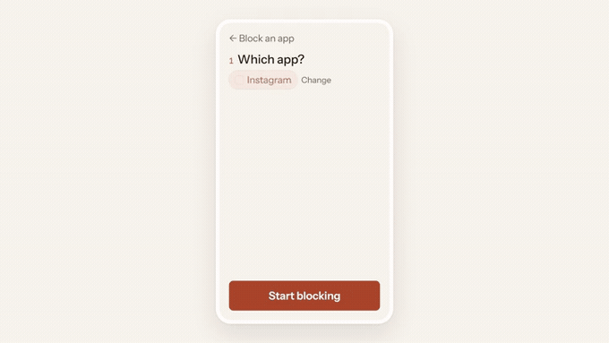

<div align="center">

# BeOffline

**Put an app down and keep it down — with someone you trust holding the key.**

BeOffline is an Android digital-wellbeing app. You pick an app you want to stay away from,
choose how firmly to hold it, and say when. When you reach for it anyway, getting back in
early means earning it or asking a person you chose.

The design mechanic is deliberate: **make giving up visible and socially costly, not impossible.**

<br />



**[▶ Watch the full video with sound (43s)](docs/marketing-video/assets/beoffline-launch.mp4)**

<br />

[Product overview](./PRODUCT_OVERVIEW.md) · [Marketing brief](./MARKETING.md) · [Project reference](./project.md)

</div>

> **Not a parental-control app.** BeOffline is a self-control tool for the user's own device
> and must never be positioned otherwise — see [`docs/PLAY_COMPLIANCE.md`](./docs/PLAY_COMPLIANCE.md).

---

## Why BeOffline

Screen-time limits are dismissed by the same person who set them. Deleting the app works
until the evening you reinstall it. Do Not Disturb hides the notification and leaves the
feed waiting. Every one of these fails exactly when willpower is low, which is the only
time they are needed.

BeOffline adds the piece those tools are missing: **a second person** — without handing
anyone control of your phone.

---

## What it does

A **block** covers **exactly one app**. Creating one is three questions on one screen:
*which app*, *how firmly*, *when*.

### How firmly — the two engines

This is the single most important thing to understand about the codebase. The two engines
are separate features that must not conflict; they share scheduling logic but never rows.

| | **Nothing loads** | **Will not open** |
|---|---|---|
| What the user sees | The app opens, but its feed stays empty | The app does not open; the block screen appears |
| What it stops | Reaching the internet | Being opened at all |
| Mechanism | `VpnService` allowlist tunnel; packets read and discarded | `AccessibilityService` watches the foreground app → overlay + send-home |
| Entity / table | `BlockRule` / `block_rules` | `OpenBlockRule` / `open_block_rules` |
| Controller | `VpnController` + `VpnStateManager` | `OpenBlockController` + `OpenBlockStateManager` |
| Scheduler | `RuleScheduler` → `ScheduleAlarmReceiver` | `OpenBlockScheduler` → `OpenBlockAlarmReceiver` |
| Permission | VPN consent | Accessibility service — optional, gated behind a disclosure screen |
| `Strictness` | `Offline` | `Locked` |

Shared logic lives in `ScheduledWindow` + `RuleScheduler.isWithinScheduledWindow()`.

### When

`PERMANENT` · `SCHEDULED` · `TIMER`, supported identically by both engines. Overnight
windows (22:00 → 06:00) work. **Saving a block turns it on** — there is no second enable step.

### The accountability layer

Three ways back into a blocked app:

| Route | How it works | `AllowanceSource` |
|---|---|---|
| **Earn it** | A challenge in the block screen, difficulty climbing with each unlock in a session. Kinds: `Arithmetic`, `Retype`, `Pattern`, `Hold` (`ChallengeEngine`) | `TEASER` |
| **Ask someone** | One paired partner approves or denies; they see the request either way | `PARTNER` |
| **Ask a group** | Up to ten approvers, **first responder wins**, with a group chat (+ @-mentions) | `GROUP` |

A successful unlock writes an `Allowance` row with an expiry (five minutes by default).
Enforcement is evaluated **per foreground event**, so expiry needs no alarms.

### Backing out

Allowed, never silent:

- Turning off a block a partner is holding you to notifies them.
- Disabling the open-block engine runs a cooldown (`disableEffectiveAt`), reboot-safe via WorkManager.
- Removing a partner or leaving a group runs a **24-hour cooldown**.
- The server treats a missing heartbeat as the uninstall signal and tells the partner.
- **Anti-puppet rule:** a relationship created while either party already has one gets
  `CanApproveAfterUtc = +24h`. The first-ever relationship on both sides is immediate.

---

## UI map

`MainActivity` → `BeOfflineNavGraph` → `MainShell` (two tabs) + pushed routes.

| Route / screen | File | Purpose |
|---|---|---|
| `welcome` | `WelcomeScreen.kt` | First run: pick an app → for how long → only the permission that choice needs |
| Shell → *Your apps* | `AppsScreen.kt` | **Home.** One list drawn from both rule tables; each row is an app, phrased as a sentence |
| Shell → *People* | `AccountabilityScreen.kt` | Sign-in, pairing, incoming/outgoing requests, groups entry |
| `block_creator?ruleId=&lock=` | `BlockCreatorScreen.kt` | **The one creator** — which app → how firmly → when |
| `app_picker` | `AppPickerScreen.kt` | Bound to `BlockCreatorViewModel` via the back-stack entry |
| `settings` | `SettingsScreen.kt` | Permissions, how you get back in, how long you get, account |
| `open_block_disclosure` | `AccessibilityDisclosureScreen.kt` | Play prominent disclosure; gates the accessibility grant |
| `group_chat/{groupId}` | `GroupChatScreen.kt` | Group chat with @-mentions, report and remove |
| (in *People*) | `GroupsScreen.kt` | Create/join a group, members, leave/remove |
| overlay (not a route) | `ui/challenge/ChallengeSurface.kt` | The block screen and its unlock challenge |

**The sentence engine** — `ui/screens/AppStateCopy.kt` is the heart of the home screen and
the only place a block becomes words ("Will not open until 6:00 PM", "Nothing loads,
weekdays until 5:00 PM"). Pure Kotlin, no `Context`, `now` always injected, every phrasing
pinned by `AppStateCopyTest`. **It is the source of truth for user-facing vocabulary** —
match it anywhere else that speaks to the user.

---

## Vocabulary

The words below are load-bearing. The left column appears nowhere a user can see, including
in the store listing.

| Never say | Say |
|---|---|
| Internet block · App Lock | a **block**, with a *how firmly* of "nothing loads" / "will not open" |
| rule · lock | block |
| engine | (nothing — `Strictness` is the internal name) |
| allowance · unlock reward | "open for N more minutes" · "how long you get" |
| accountability · social | **People** |
| challenge kinds | "how you get back in" |
| VPN access | "let BeOffline hold traffic" |
| accessibility service | "let BeOffline see what's open" |
| "Protection is off" | "Nothing is blocked" |

Sentence case throughout, never Title Case.

---

## Design system

`ui/theme/` — the **Paper** palette, light-first, one accent, no second accent.

| Token | Hex | Use |
|---|---|---|
| Ground | `#F7F3ED` | Screen background |
| Card | `#FFFFFF` | Raised surface, 1px `#E6DED2` border |
| Sunken | `#EFE9E0` | Segmented tracks, inert tiles |
| Ink | `#1C1915` | Primary text, dark button fills (15.2:1) |
| Ink muted | `#6B635A` | Secondary text — **the floor for any text** (5.3:1) |
| Ink faint | `#8C8276` | Icon strokes only, never text (3.4:1) |
| Clay | `#A8452A` | The accent: fills, accent text (5.4:1) |
| Clay wash | `#F6E7E0` | Selected rows and chips |
| Amber | `#8A5A12` | "Running on borrowed time" |

- **No destructive red.** Ending a block early or dropping a partner is written in *ink
  muted* — possible, never inviting. A product decision, not an oversight.
- Clay and amber differ in lightness as well as hue, so the live states stay distinguishable
  without colour.
- Radius 14 on cards and buttons, 11 on app icons, 999 on chips. Tap targets ≥ 44×44.
- Type: **Instrument Sans** (400/500/600) + **JetBrains Mono** (timers, counts, eyebrows).
  Both are **bundled in the APK** — a runtime fetch from Google's servers is a GDPR problem.
- Never heavier than `FontWeight.Medium`.
- Components live in `BoComponents.kt` (`BoCard`, `BoEyebrow`, `BoToggle`, `BoPrimaryButton`,
  `BoScreenHeader`, `BoEmptyState`, `BoAppIcon`, `BoStepTrack`, …).

Light theme only. There is no dark scheme, and Compose only — no XML layouts.

---

## Tech stack

Kotlin 1.9.24 · AGP 8.6.1 · minSdk 26 · targetSdk 36 · JDK 17

Jetpack Compose + Material 3 (one `MainActivity`, Navigation Compose) · Room (DB **v7**) ·
Hilt · MVVM with `StateFlow` UiState · Coroutines/Flow · WorkManager + exact `AlarmManager` ·
Retrofit/Gson · Firebase Auth + FCM + Crashlytics (BOM **pinned 33.1.2**) ·
SignalR `8.0.0`.

Release builds are minified: `isMinifyEnabled = true` with `isShrinkResources = true`, so
**keep rules in `proguard-rules.pro` must be earned** — anything reached only by reflection
(Gson model classes and their `TypeToken`s above all) needs a rule or the first Room read
takes the release build down.

---

## Project structure

```
D:\BeOffline
├── app/                           Android app — one Gradle module, 100% Kotlin
│   └── src/main/java/com/beoffline/app/
│       ├── accountability/        Firebase auth, Retrofit ApiService, repository, FCM, SignalR, workers
│       ├── background/            BackgroundProtectionManager (OEM autostart/battery deep-links)
│       ├── data/local/            Room DAOs, Converters, BeOfflineDatabase
│       ├── data/model/            BlockRule, OpenBlockRule, Allowance, ScheduledWindow, accountability entities
│       ├── data/repository/       BlockRuleRepository, OpenBlockRuleRepository
│       ├── di/                    AppModule, NetworkModule (Hilt)
│       ├── notifications/         BlockedAppNotificationListenerService
│       ├── openblock/             a11y service, BlockOverlayManager, ChallengeEngine/Controller, prefs
│       ├── receiver/              Boot, schedule alarms, VPN recovery
│       ├── scheduler/             RuleScheduler, OpenBlockScheduler
│       ├── ui/                    All Compose — see the UI map above
│       └── vpn/                   BeOfflineVpnService, VpnController, VpnStateManager, resilience
├── app/schemas/                   Room exported schemas 1..7 — KEEP COMMITTED
├── backend/                       ASP.NET Core 8 API
└── docs/                          Compliance, release, deployment, Play listing
```

---

## Getting started

### Requirements

- Android Studio with the Android SDK (compile/target 36)
- JDK 17
- A device or emulator on Android 8.0+ (`minSdk 26`)

### Build and test

```bash
./gradlew :app:assembleDebug              # build
./gradlew :app:testDebugUnitTest          # 58 JVM tests
./gradlew :app:connectedDebugAndroidTest  # incl. MigrationTest — needs a device
cd backend && dotnet test                 # backend tests
```

The debug APK lands at `app/build/outputs/apk/debug/app-debug.apk`.
Release steps are in [`docs/RELEASE_BUILD.md`](./docs/RELEASE_BUILD.md).

Work on `dev`; the main branch is `master`. `.gradle-build*` directories are scratch.

---

## Backend

`backend/` — ASP.NET Core 8, EF Core 8 + Npgsql/PostgreSQL, on an OCI VM at
`beoffline-api.askthepolicy.com` (Cloudflare-proxied). Deployment and first-time setup:
[`docs/BACKEND_DEPLOYMENT.md`](./docs/BACKEND_DEPLOYMENT.md).

- **Auth:** Firebase JWT bearer validation; users auto-provisioned by middleware; the
  Firebase UID is the primary key.
- **Push:** FCM via FirebaseAdmin, **data-only messages** — the client builds its own routed
  notification.
- **Realtime:** SignalR `AccountabilityHub` at `/hubs/accountability`.
- **Controllers:** pairing/invites, requests (idempotent, 15-minute expiry, atomic
  first-responder claim guarded on `Status == Pending`), groups, chat, device heartbeat,
  tamper, account deletion (`DELETE /api/account`, transactional purge).
- **Public pages:** `/privacy` and `/account-deletion` (`LegalPages.cs`).

**Block rules are never synced to the server** — a deliberate privacy-minimal v1 decision.

---

## Permissions

| Permission | Why |
|---|---|
| `BIND_VPN_SERVICE` | The "nothing loads" engine |
| `BIND_ACCESSIBILITY_SERVICE` | Foreground-app detection for "will not open" |
| `SYSTEM_ALERT_WINDOW` | The full-screen block overlay (falls back to send-home without it) |
| `POST_NOTIFICATIONS` | Approval and tamper notifications, VPN status |
| `RECEIVE_BOOT_COMPLETED` | Re-arm active blocks after a reboot |
| `REQUEST_IGNORE_BATTERY_OPTIMIZATIONS` | Keep enforcement and heartbeat reliable on aggressive OEMs |
| `FOREGROUND_SERVICE` + `_SYSTEM_EXEMPTED` | Keep the VPN alive |
| `WAKE_LOCK` | WorkManager reliability |

The accessibility service declares `typeWindowStateChanged` only,
`canRetrieveWindowContent="false"` and `isAccessibilityTool="false"`. It observes **which
app came to the front and nothing else**, and transmits nothing off the device. There is no
`QUERY_ALL_PACKAGES` — the picker uses a launcher-only `<queries>` filter.

Permissions are requested **in context, at save time**, and only the ones the chosen
strictness needs. Android background behaviour varies by manufacturer; the app guides
users through the settings that matter rather than claiming uniform reliability.

---

## Conventions and traps

- **Never** reintroduce `fallbackToDestructiveMigration()`. It was once used on a published
  database. Any new entity or column needs a real `Migration`, a version bump, and a
  committed schema, or shipped users lose their blocks.
- **Never** make FCM messages notification+data — background delivery breaks. Data-only.
- Don't bump the Firebase BOM past 33.x while on Kotlin 1.9.24 (34.x needs Kotlin 2.x metadata).
- Keep rules must cover anything reached reflectively. Gson's `TypeToken` included.
- Dates cross the wire as ISO strings → `java.time.Instant`. .NET's 7-digit fractional
  seconds break `SimpleDateFormat`.
- One partner at a time (1:1); groups are the many-approver path.
- Exact alarms are guarded by `canScheduleExactAlarms()` and fall back to inexact.
  Enforcement is per-foreground-event and needs no alarms for correctness.
- Secret hygiene: base `appsettings.json` keeps `Password=CHANGE_ME`. The real Postgres
  password lives only in `appsettings.Production.json` on the VM. One has leaked into the
  working tree before — check before every commit.

---

## Documentation

| File | What it is |
|---|---|
| [`project.md`](./project.md) | Project reference — read first when picking up the code |
| [`PRODUCT_OVERVIEW.md`](./PRODUCT_OVERVIEW.md) | Product narrative, features, positioning, FAQ |
| [`MARKETING.md`](./MARKETING.md) | Promotion brief: pitches, objections, paste-ready copy, words to avoid |
| [`docs/PLAY_COMPLIANCE.md`](./docs/PLAY_COMPLIANCE.md) | **Read before any store work.** Policy, data safety, banned words |
| [`docs/play-listing/listing-copy.md`](./docs/play-listing/listing-copy.md) | The live store copy, character counts verified |
| [`docs/RELEASE_BUILD.md`](./docs/RELEASE_BUILD.md) | Signing and release build steps |
| [`docs/BACKEND_DEPLOYMENT.md`](./docs/BACKEND_DEPLOYMENT.md) | Backend deploy and update path |

`TECHNICAL_FLOW_DIAGRAM.md` still describes the pre-2026-10-18 UI and the VPN engine only.
It has not been redrawn for the current product.

---

## Status

Live on Google Play as `com.beoffline.app` (publisher OmGLabs), current build **v1.1.2
(versionCode 12)**. Free, with no ads, subscriptions, or in-app purchases.

Both engines, all three timings, and the full accountability layer — solo challenges,
1:1 partners, and groups with chat — are implemented. Ongoing work is device-level
reliability across OEMs, and Play Console configuration.
